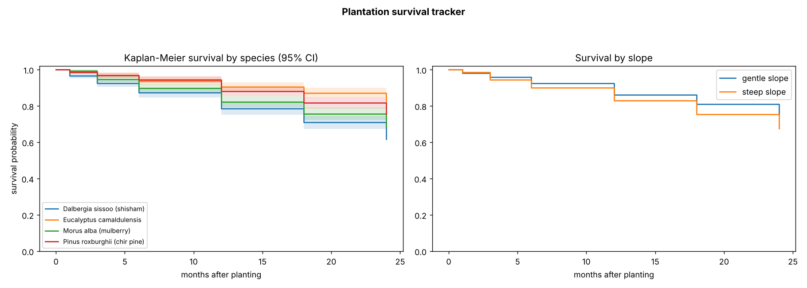

# Plantation Survival Tracker (Kaplan–Meier)

> **Simulation-based case study.** 2,400 hypothetical saplings across 8 sites and 4 species, checked at 1, 3, 6, 12, 18 and 24 months. Trees with lost tags are handled as censored observations rather than counted as dead.



## Why survival analysis
Counting "trees planted" overstates impact. Survival analysis answers what funders actually ask: **how many trees are alive after two years, and what drives losses?** It handles trees whose tags were lost, or that haven't reached later visits yet, without biasing the result.

## Methods
- Kaplan–Meier estimator with Greenwood 95% confidence intervals, implemented from first principles and checked against a textbook example in the tests
- Log-rank test comparing species and slope classes
- 24-month survival by site, for targeting replanting

## Results on the simulated data
| Metric | Value |
|---|---|
| Trees / deaths observed / censored | 2,400 / 653 / 1,747 |
| 24-month survival by species | Eucalyptus 82.6%, chir pine 75.6%, mulberry 68.3%, shisham 61.6% |
| Species difference (log-rank) | chi-square 69.5, p < 0.001 |
| Steep vs gentle slope (log-rank) | chi-square 14.0, p < 0.001 |

## Run
```bash
python3 -m unittest discover -s tests -v
python3 src/survival.py
```

Author: Mohammad Rabbani – Sustainability Data Analyst & Research Consultant

## Links
- Kaggle notebook: https://www.kaggle.com/rabbani0123 (runnable copy of `notebook.ipynb`)
- Author: Mohammad Rabbani | Sustainability Data Analyst & Research Assistant

## License
MIT
